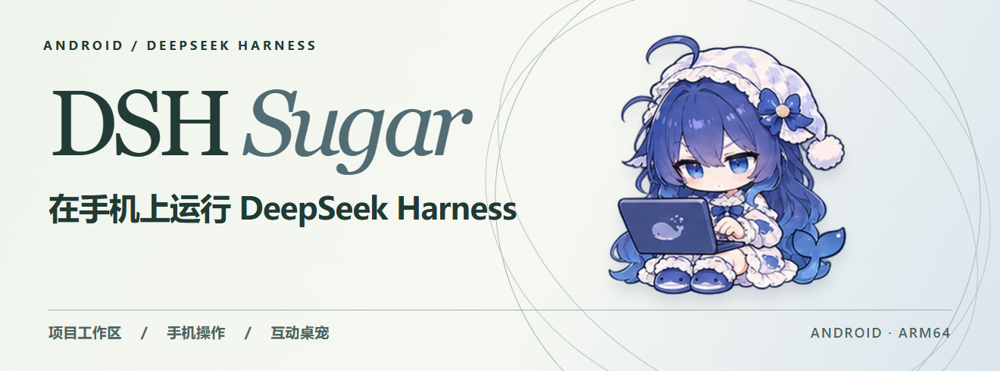
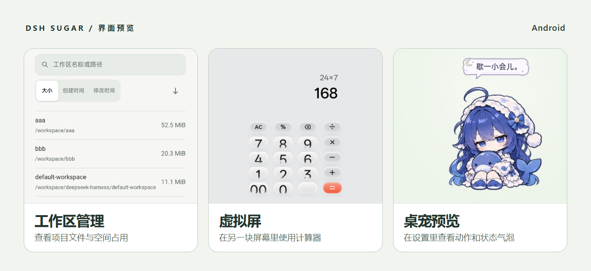
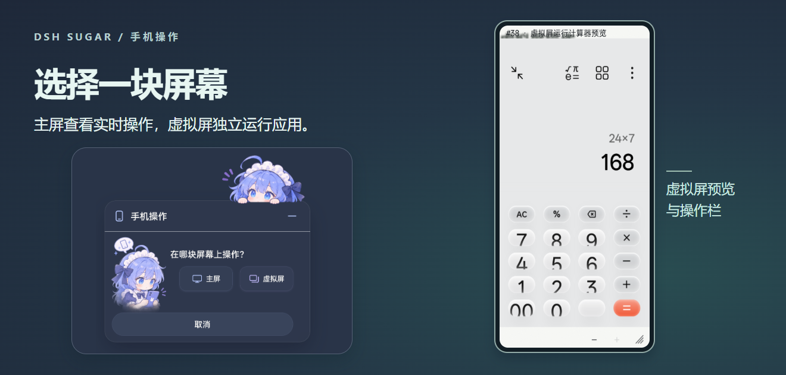
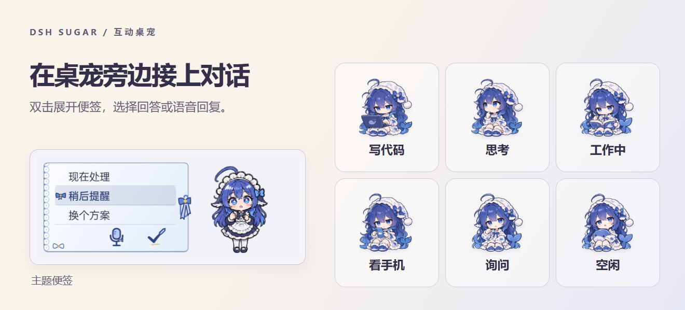

# DSH Sugar



**在 Android 手机上运行 DeepSeek Harness。** 在熟悉的 DSH 对话里写代码、开终端、交付文件，也可以把当前屏幕或一块独立的虚拟屏交给 Agent 操作。DSH 和项目的 Linux 环境都运行在手机上，首次使用时在 WebUI 中配置模型供应商即可。

**[下载 v0.1.0 APK](https://github.com/xiaoxiao44443/DSH-Sugar/releases/tag/v0.1.0)**　·　适用于 Android 10 及以上的 ARM64 手机，无需 root。

[开始使用](#开始使用)　·　[从源码构建](#从源码构建)　·　[交流群](#交流群)

## 界面预览

[](docs/preview/sugar-tour.png)

从屏幕侧边滑出导航，可以回到上一条对话、刚看过的文件或 Sugar 设置。横屏时导航依然贴在侧边，图标和时钟会随页面底色调整。点上图可看原尺寸。

## 在手机上可以做什么

| 能力 | 使用方式 |
| --- | --- |
| **在项目里工作** | 每个工作区有自己的 `/workspace`、终端和项目进程。同一项目的多个对话接着用原来的文件，Bash、Git、curl、Python 和 Node.js 都可在本机执行。所有工作区共用一份 DSH，模型配置、已安装插件和会话记录按会话权限访问。 |
| **把文件留在合适的地方** | 可以用 Sugar 内部目录做项目，也可以通过 Android 系统选择器把手机目录直接设为工作区。系统「文件」能浏览内部项目，产物可下载到手机或交给其他应用。存储页按工作区列出文件和会话，能查看图片、阅读代码、清理会话附件。 |
| **按自己的习惯使用** | 可调整侧边导航的透明度、磨砂、停靠位置和转场，也可自定义启动图、文字与桌宠大小。DSH 启动异常时，可从「诊断与恢复」用临时配置排查，或用内置版本修复正在使用的 DSH。 |

### 让 Agent 操作哪块屏幕，由你选

比如让 Agent 打开计算器核对一笔账。选主屏时，你能看见它打开应用、按键和读数的全过程。选虚拟屏时，计算器在另一块屏幕里运行，主屏可以继续用。两种模式共用一套 Python 接口，能读取控件、截图、点击、长按和拖动，也能按页面状态等待下一步。

[](docs/preview/mobile-control.png)

### 在其他应用里也能接上对话

桌宠写代码时会敲键盘，等你做决定时会换成询问动作。双击桌宠展开便签，就能选答案或发快捷短句。启用语音插件后，还能口述一条回复，确认后送到当前任务。任务完成、提问或需要审批时，也可以通过通知回到对应的对话。

[](docs/preview/desktop-pets.png)

## 开始使用

1. 在 **Android 10 或更新版本的 ARM64 手机**上安装 Sugar APK。第一次打开会展开 Linux 环境，请预留安装空间。之后启动会复用已准备好的环境。
2. 进入 DSH WebUI，登录或配置自己的模型供应商。打开默认工作区即可开始对话，也可以选择一个手机文件夹，从已有项目开始。
3. 想让 Agent 操作手机时，打开 **Sugar 设置 → 手机操作**，启用要用的屏幕。试一句「打开计算器，算一下 1+1」，在对话浮窗里选主屏或虚拟屏。

| 手机操作方式 | 设备要求 | 如何启用 |
| --- | --- | --- |
| 主屏 | Android 10+；主屏截图需 Android 11+ | 在系统设置中启用 Sugar 的无障碍服务。 |
| 本机无线 ADB | Android 11+ | 开启无线调试，在 Sugar 里完成配对并点「连接本机」。 |
| 虚拟屏 | Android 14+ | 连接本机无线 ADB，开启 Sugar 的虚拟屏开关。 |

## 从源码构建

项目包含 Android App、Kotlin Multiplatform 共享模块，以及将 DSH 与 Linux 工具打包到手机的脚本。当前打包的 DeepSeek Harness 版本为 **0.2.2-rc.3**。[DeepSeek Harness 上游](https://github.com/deepseek-ai/deepseek-harness/releases/tag/dsh-v0.2.2-rc.3) · [Sucrune 运行时](https://github.com/xiaoxiao44443/Sucrune)

<details>
<summary><strong>Windows 构建步骤</strong></summary>

将 `DSH-Sugar` 与 `Sucrune` 克隆为同级目录。准备 PowerShell 7、Git、JDK 17、Android SDK 37、NDK、CMake、Go 1.24+、Python 3.11+、Node.js 和 Zig 0.17.1。设置 `JAVA_HOME`、`ANDROID_HOME`、`ANDROID_NDK_HOME`，并将命令行工具加入 PATH。

在 **Sucrune** 根目录准备 ARM64 Linux 基础层、工具包和运行时。以下版本与本项目首次公开的源码配套。

```powershell
git checkout f9eb0a1f51c256c151fd63e6d4503c7335c8c11a
$readelf = Join-Path $env:ANDROID_NDK_HOME 'toolchains/llvm/prebuilt/windows-x86_64/bin/llvm-readelf.exe'
.\scripts\prepare-linux-rootfs.ps1 -IncludeNode
.\scripts\prepare-linux-bash.ps1 -ReadElf $readelf
node scripts/prepare-linux-node-pty.cjs
python scripts/prepare-linux-stty.py --readelf $readelf
python scripts/prepare-linux-base-tools.py
python scripts/prepare-git-curl.py
python scripts/prepare-linux-python.py
python scripts/prepare-toolbox-fixture.py
.\scripts\build-android.ps1 -Variant validation
```

然后切到 **DSH-Sugar** 根目录构建应用。

```powershell
.\scripts\build-android.ps1 -SucruneRoot ..\Sucrune -Python python
```

脚本会准备固定版本的 DSH 和工具、运行单元测试与 Android lint，并生成 `app/build/outputs/apk/debug/app-debug.apk`。开发机已连接手机时，可用 `adb install -r app/build/outputs/apk/debug/app-debug.apk` 安装。

</details>

## 开发文档

- [Android 使用与开发记录](docs/android-notes.md)　配置文件、首次启动、构建参数与历史真机验证。
- [工作区与文件](docs/projects-and-files.md)　项目隔离、共享 DSH 数据、手机目录与系统文件管理器。
- [手机操作脚本](app/src/main/assets/guest/mobile-use-guide.md)　使用 `mobile_use` 观察屏幕、执行动作、等待事件或接受用户插话。
- [桌宠制作](docs/desktop-pets.md)　六种动作、上下气泡与主题回答便签的资源约定。
- [升级 DeepSeek Harness](docs/dsh-upgrades.md)　升级打包版本时需要检查的适配点。

## 许可证

DSH Sugar 的项目代码采用 MIT 许可证。DeepSeek Harness、Sucrune 和 APK 随附的 Linux 工具沿用各自的许可证。发布页随 APK 提供第三方告示和组件来源。[MIT 许可证](LICENSE) · [v0.1.0 发布页](https://github.com/xiaoxiao44443/DSH-Sugar/releases/tag/v0.1.0)

## 交流群

**DSH Sugar交流群**　·　QQ群 **1132763851**
