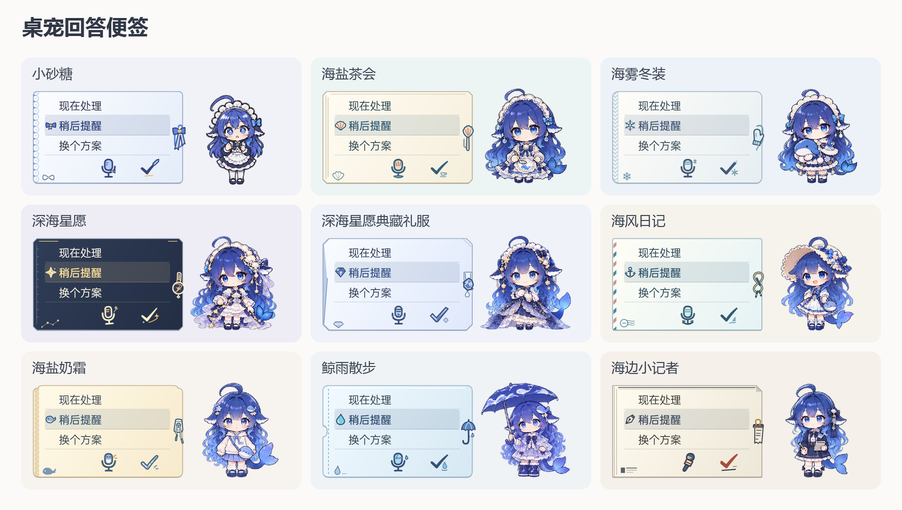

# Sugar 桌宠制作指南

做一套新桌宠，交付 **6 个透明循环动画、1 份名称清单、上置和下置各 1 张气泡，以及 1 套回答便签**。角色、气泡和便签各自绘制，文字由 App 排版。可以用「鲸雨散步」作样板，从角色撑伞的姿势、气泡尾尖一路对照到便签上的雨滴和伞柄。[角色动画与清单](../app/src/main/assets/pets/paopao09_rain/) · [上置气泡原图](../app/src/main/res/drawable-xxhdpi/pet_bubble_paopao09_rain.9.png) · [下置气泡原图](../app/src/main/res/drawable-xxhdpi/pet_bubble_paopao09_rain_below.9.png)

## 1. 先定六个动作

先画一张六格姿势稿，把它缩到桌宠默认的 **112 dp**，看人物只靠姿势和道具能否区分六种状态。第一帧就画出状态特征，设置页会取每段动画的首帧拼成缩略卡。

| 状态 | 导出文件 | 一圈动作怎么画 |
| --- | --- | --- |
| 看手机 | `phone.webp` | 一手持手机，另一手划屏，眼睛抬起再落回屏幕。 |
| 写代码 | `coding.webp` | 笔记本落在膝上，双手交替敲键，在一次短暂停顿后接回起势。 |
| 思考 | `thinking.webp` | 托腮、目光上移、眨眼，回到托腮的位置。 |
| 无所事事 | `idle.webp` | 轻晃脚尖，或看看手里的茶杯。动作幅度小，停顿可以长一些。 |
| 询问 | `asking.webp` | 歪头、抬手摊掌，停在等待回应的姿势，再慢慢收手。 |
| 工作中 | `working.webp` | 选与角色有关的一件事，如在记录板上勾选一项。画完整的落笔、接触、提笔。 |

**道具先想清楚由谁拿、放在哪。** 雨衣款的第一版里，呆毛穿过伞顶，手和伞柄也没有连起来。重画时把撑伞和收伞分成两组。思考、空闲、询问时，一手握住伞杆，头顶始终在伞面下。看手机、写代码、工作时，折伞靠在脚边，双手就能自然地操作。审稿时把整个循环逐格看完，尤其留意歪头、抬手和动作幅度最大的那一帧。[撑伞思考](../app/src/main/assets/pets/paopao09_rain/thinking.webp) · [收伞写代码](../app/src/main/assets/pets/paopao09_rain/coding.webp)

## 2. 画原帧，接成循环

- 固定头身比、配色、视角和镜头距离。用站姿的脚底或坐姿的着地点做对齐基准。一段动作共用同一缩放比例，给发梢、裙摆、鲸尾和道具走到最远的位置留出透明边距。
- 拆出起势、预备、接触或停顿、回收几个关键姿势，再补手腕、眼神和衣角的中间帧。检查最后一帧接回第一帧的瞬间，避免整个人跳位或在接缝处多停一拍。
- 原画张数按动作选择。泡泡系列每个状态用了 **6 张独立绘制的帧**，默认小砂糖用了 **16 张**。动作跨度大就补中间帧。眨眼、敲键可以快，阅读、思考可以在关键帧多停一会儿。
- 批量画泡泡时采用两张图集，每张 **6 列 × 3 行**。每一行从左到右是一段完整循环。第一张依次放看手机、写代码、思考，第二张放空闲、询问、工作中。逐格切出后检查伞尖、鞋底和与人物分离的小道具，再放到统一画布上。

**可复用的绘图提示词骨架**

> 根据参考图画「[角色／服装]」的手机桌宠逐帧动画。保留[发型、服装、识别配件]，使用[线条和上色风格]。本行是[状态]，六格从左到右依次画[六个连续姿势]。人物朝向、比例、脚底基线和镜头固定。[哪只手握住什么、道具和身体的前后关系]在每一格都清晰可见。全身和道具画完整，格子之间留透明空隙，使用真正的透明背景。仅绘制角色和本动作的道具，气泡和文字单独制作。

现有两系列都导出为 **384 × 384 的动画 WebP**，带 alpha 通道和无限循环标记，帧时长以毫秒写入文件。泡泡系列可作为节奏参考，每格看手机 118 ms、写代码 86 ms、思考 145 ms、空闲 159 ms、询问 119 ms、工作中 99 ms。新动作可以单独调整每格的停留时长。

下面的 Python／Pillow 示例读取已经对齐的 6 张 RGBA 原帧，在当前目录生成一段有长短停顿的思考动画。原帧用两位数编号，`duration` 数组与播放顺序一一对应。

```python
from pathlib import Path
from PIL import Image

frames = []
for path in sorted(Path("frames/thinking").glob("*.png")):  # 01.png … 06.png
    with Image.open(path) as source:
        frames.append(source.convert("RGBA"))

durations = [145, 110, 110, 165, 135, 145]
assert len(frames) == len(durations)
assert all(frame.size == (384, 384) for frame in frames)
frames[0].save("thinking.webp", save_all=True, append_images=frames[1:],
               duration=durations, loop=0, quality=93, method=4)
```

## 3. 分别画上置和下置气泡

「上置」和「下置」指**气泡相对人物的位置**。常态气泡在人物上方，尾尖朝下。桌宠拖到屏幕顶部、上方空间不足时，气泡会移到人物下方，换成尾尖朝上的下置图。两张图共用轮廓语言和配色，分别画好尾尖、徽章和阴影。雨滴仍向下落，报纸字样仍正着读，高光和投影的方向也要一致。尾尖放在靠左的固定区域，当前浮窗以距左边约 24 dp 的位置对准人物中心，靠近屏幕边缘时会把气泡限制在屏内。

文件放在 `app/src/main/res/drawable-xxhdpi/`。下面是泡泡系列可直接套用的九宫格模板。单位为 **xxhdpi 源图像素**，四边顺序均为 **左、上、右、下**。

| 素材 | 含标记的 PNG 尺寸 | 四边保留宽度（中间可拉伸） | 文字内边距 |
| --- | --- | --- | --- |
| `pet_bubble_<id>.9.png` | 386 × 146 | 114、48、48、54 | 69、27、42、45 |
| `pet_bubble_<id>_below.9.png` | 386 × 146 | 114、66、48、36 | 69、45、42、27 |

外圈留 **1 px** 作为 Android 九宫格标记，实际画布为 **384 × 144**。在上边和左边用纯黑像素标出可拉伸区域，在下边和右边标出内容区域，其余标记像素透明。把尾尖、花纹、徽章和圆角放在固定区域内。上下款保持等大、同样的左右内边距和相等的垂直内边距总和，这样换边时文字不会跳动。默认小砂糖使用较高的 **386 × 206** 模板，修改原款时以对应源图为准。[默认上置图](../app/src/main/res/drawable-xxhdpi/sugar_pet_bubble.9.png) · [默认下置图](../app/src/main/res/drawable-xxhdpi/sugar_pet_bubble_below.9.png)

气泡里留出完整文字区。App 单独绘制文字并负责打字和长句滚动，人物缩放不会带动文字缩放。设置中的放大预览使用上置款，Web 预览按固定切片绘制。若采用另一套上置切片或内边距，需同时核对预览样式和真机浮窗。[预览样式](../app/src/main/assets/sugar-pets.css) · [原生气泡](../app/src/main/kotlin/app/dsh/sugar/DesktopPetBubble.kt)

气泡正文使用普通任务的命令 `description`、助手回复摘要和手机任务的 `phone.status`，在同一会话、同一回合内按原始事件时间选择最近的有效内容。无新信息的轮询保留正文和更新时间，不显示原始命令或工具输出。

已经显示的回复会保留到首遍阅读结束，再切换到最新的普通命令说明；读完本身不会清除回复，也不会依次重放期间积压的旧步骤。询问、完成、新回复，以及切换会话或开始新回合，会立即结束这段阅读保护，避免沿用旧内容。

普通命令、文件工具和手机操作的非零退出码或工具错误仅保留在对话执行记录中，不会自动生成错误气泡，也不会打断已有回复；问题和处理进展由助手的公开回复说明。轮次异常会结束忙碌状态，具体错误仍在对话中呈现，不自动生成宠物报错或完成通知。

活动正文超过 **30 秒**没有新信息时，在正文下方用小字显示「上次更新 · 0:30 前」，随后每 **5 秒**刷新一次。它表示内容的年龄，不代表底层脚本仍在执行。完成结果、等待陪伴输入和询问状态不显示这行时间。设计气泡时为这行小字留出空间，更新小字不应重新开始正文的打字或滚动。

## 4. 接入 Sugar

在 `app/src/main/assets/pets/<id>/` 放入六个 WebP 和一份 `manifest.json`。ID 也是保存在用户设置中的值，允许小写英文字母、数字、短横线和下划线，首字符为字母或数字。重画现有宠物时沿用原 ID，直接替换动画。默认 `sugar` 固定排第一，其余按 ID 字符顺序排列；同系列可用 `paopao01_tea`、`paopao02_winter` 这样的补零编号固定先后。

```json
{
  "names": {
    "zh": "泡泡 · 鲸雨散步",
    "en": "Paopao · Whale Raincoat",
    "ja": "パオパオ・クジラの雨さんぽ"
  }
}
```

App 在下次构建后自动发现目录。名称依次取当前语言、英文、目录 ID。缺少清单或任一状态文件，整套会被跳过。气泡按资源名分别查找，缺哪一侧就使用默认款对应方向的气泡。资源名中的短横线换成下划线，给新宠物取 ID 时也要避免转换后与已有气泡重名。[加载与排序实现](../app/src/main/kotlin/app/dsh/sugar/DesktopPets.kt)

## 5. 给回答便签配一套文具

气泡显示当前问题或状态。便签在宠物身边展开，承载答案选项或快捷回复。先从服装或随身道具挑一个在小尺寸下也好认的元素，用它设计纸张、选中标记和收起饰件，再把颜色或轮廓带到语音、确认图标上。

### 纸面布局与交互

- **纸张贴着宠物，高度随内容变化。** 两项时纸短，多项时只滚动选项区。以人物方框边长为基准，高度最多取 89.5%，首选宽度取 1.46 倍，最多 218 dp，并随屏侧余宽收窄。装饰放在装订边、角和页脚，中央留给文字。拖到屏幕另一边时，收起饰件跟到靠宠物的一侧，纸面文字保持正向。
- **选项每行一句。** 左侧给选中标记预留位置，选中后文字不跳位。用主题图形和淡色底一起表示选中，例如雨滴、雪花或钢笔尖。长句平时显示省略号，选中后可水平往返滚动。列表的纵向滚动条纤细，滑动后淡出。
- **操作按钮采用「纸内页角」。** 麦克风和确认图标印在纸内右下角，麦克风在左，确认在右。给图标保留易辨认的轮廓和独立点击区域。纸边的小饰件负责收起，可以画成回形针、手套或绳结。收起后双击宠物可再展开，同一问题保留未提交的选择，气泡继续显示当前问题。空闲且没有关联对话时，维持原有双击行为。
- **录音也在纸内完成。** 语音识别可用且当前问题允许自定义回答时显示麦克风。录音状态占用原选项区，页脚提供取消和完成录音。空间紧时优先显示状态文字。转写完成后，文本占一行并自动选中，再录一次就替换这行。用户点确认后才提交。
- 在 Sugar「设置 → 桌宠 → 语音回复」可查看本地语音插件和模型的状态，并进入 DSH 配置。插件详情的麦克风电平预览和桌宠录音共用 Sugar 的 Android 麦克风权限；任一入口首次采集音频时，系统会按当前授权状态处理。

### 已有主题参考

| 宠物 | 纸面 | 选中标记 | 靠宠物的收起饰件 |
| --- | --- | --- | --- |
| 小砂糖 | 浅蓝花边信纸 | 蝴蝶结 | 缎带结 |
| 海盐茶会 | 奶油色双线茶单 | 扇贝 | 贝壳小匙 |
| 海雾冬装 | 雪白针织边便笺 | 雪花 | 连指手套 |
| 晚安鲸梦 | 淡紫缝线睡前手帐 | 弯月 | 月牙回形针 |
| 深海星愿 | 深蓝星图、浅金墨线 | 星芒 | 星盘挂夹 |
| 深海星愿典藏礼服 | 冰蓝宝石切角纸 | 蓝宝石 | 宝石胸针 |
| 海风日记 | 蓝红邮边明信片 | 船锚 | 航海绳结 |
| 海盐奶霜 | 奶油色标签、格纹边 | 小鲸鱼 | 抽绳扣 |
| 鲸雨散步 | 浅蓝雨票、两侧票口 | 雨滴 | 带弯柄的小伞 |
| 海边小记者 | 折角报纸、细栏线 | 钢笔尖 | 稿纸夹 |

下图是九款新增便签在 Android 上的实际渲染，均选中第二项，便于并排比较标记、墨色和纸边饰件。



### 新宠物如何接入

在 `app/src/main/res/drawable/` 添加四枚 Android 矢量图，文件名使用 `note_<id>_mark.xml`、`note_<id>_clip.xml`、`note_<id>_mic.xml`、`note_<id>_confirm.xml`。资源名里的短横线换成下划线，主题注册使用清单目录的原 ID。用 10–13 dp 检查选中标记，17–23 dp 检查语音和确认图标，细节以缩小后仍能分辨为准。[雨滴标记](../app/src/main/res/drawable/note_paopao09_rain_mark.xml) · [小伞饰件](../app/src/main/res/drawable/note_paopao09_rain_clip.xml)

在 `PetNoteTheme` 注册宠物 ID、正文色、墨色、强调色和四个图标，在 `PetPackPaperDrawable` 按同一 ID 绘制纸张轮廓与边饰。预览和桌面共用这个主题。晚安鲸梦沿用已有的专属纸面和手绘月牙回形针，未注册主题的宠物会显示小砂糖款。[主题注册](../app/src/main/kotlin/app/dsh/sugar/PetNoteTheme.kt) · [纸面绘制](../app/src/main/kotlin/app/dsh/sugar/PetPackPaperDrawable.kt) · [便签布局](../app/src/main/kotlin/app/dsh/sugar/DesktopPetAnswerNote.kt)

## 6. 交付前验收

1. **逐帧看片。** 在浅色、深色底上分别播放六个循环，检查是否有白边、残留棋盘格、相邻格碎片或丢失的道具。对齐首尾帧再看一遍，确认手确实握着物体、头发和衣摆的遮挡关系正确。透明边缘检查无法发现画面内部的穿模。
2. **构建并覆盖安装。** 按项目 README 配置 Android 构建环境。已有可复用的 guest 资源时，在 Sugar 根目录执行以下命令。[Android 构建说明](../README.md#构建-android-apk)

   ```powershell
   .\scripts\build-android.ps1 -SkipGuestPreparation
   adb install -r .\app\build\outputs\apk\debug\app-debug.apk
   ```

3. **验选择和播放。** 进入「Sugar 设置 → 桌宠」，查看卡片位置及六格首帧，点选后放大，逐个切换六种状态，至少看完两圈。若缩略卡正常、桌面却不播放，先检查 WebP 是否确实含有多个可解码的帧。重画旧款时也检查原先的选择能否保留。选择区可横向滑动，竖屏最多三行，横屏按高度最多两至三行。
4. **验桌面实物。** 开启桌宠，分别在 64、112、192 dp 看人物与气泡。用一条短句和一条超长句检查打字、滚动和装饰留白。拖到屏幕上沿再拖回，确认两种尾尖始终指向人物、文字方向正常且打字进度连续。切换横竖屏，检查贴边处是否裁字。
5. **验便签预览。** 在「设置 → 桌宠 → 放大预览 → 询问 → 回答便签」看实际选中态、纸内按钮和纸边饰件。点饰件收起，双击预览里的宠物再展开。预览的麦克风按钮可手输模拟转写，确认结果显示在预览气泡中。[设置预览实现](../app/src/main/kotlin/app/dsh/sugar/PetAnswerPreview.kt)
6. **验便签实物。** 在有目标对话的桌面浮窗中，用两项单选和六项多选覆盖短纸面、长列表及末项滚动。在 64、112、192 dp 下分别把宠物拖到左右两侧，检查换边连续、纸面贴近角色、饰件可点、页脚始终可见。再用支持自定义回答的问题检查录音、转写、替换和确认。深色纸重点看正文、选中标记、录音状态和禁用按钮的亮度。记录实测用的宠物、尺寸，以及语音走的是真实录音还是模拟转写。

交付时建议保留角色参考图、动作提示词或分镜、透明原帧或分层源稿、每帧时长和最终资源。将这些与整套预览放在长期素材目录，后续只需重画某个动作时，可以直接沿用同一套角色比例和锚点。本次泡泡交付包 `paopao-desktop-pets.zip` 的 `art/generation-prompts.md` 收录了九套提示词，包括雨衣款的重画版本。包内的 `assets/` 和 `res/` 对应 Sugar 的 `app/src/main/`。
